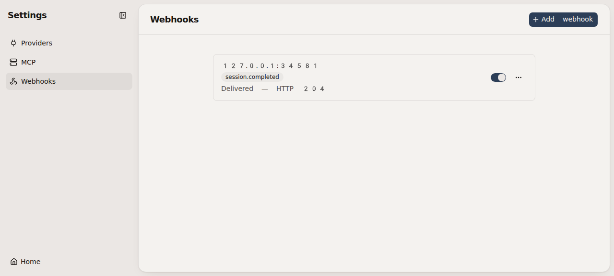
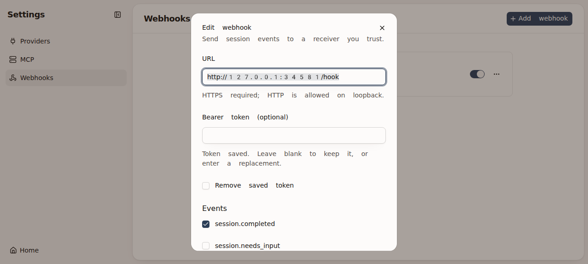

# PIN-100 verification

Contract: [PIN-100](https://linear.app/goofansu/issue/PIN-100/settings-webhooks-post-subscribed-session-events-to-user-configured).
Implementation: `41d69720006bad1429d28dfb01c6aff425db753b`, based on `33eefd8`.
The working-tree runtime code tested below is the code in that commit; the final pre-commit
edit only clarified the last-answer helper's comment. This report and its attachments are
subsequent evidence-only changes.

Environment: exe.dev Linux, Node 24.22.0, Worktrunk 0.80.0, installed Pi 1.4.0.
Feature browser journey: agent-browser 0.39.1, fake Pi, isolated HOME/database/Pi directories,
throwaway Git repository, backend `127.0.0.1:32819`, Vite `127.0.0.1:35047`, loopback HTTP receiver
`127.0.0.1:34581`. No model credits, production restart, live database or user session-file edits.

## Claims and checks

Preserves INV-01 (Pi/history and integration policy ownership), INV-02/03 (live server-owned
session facts), INV-05 (nonblocking bounded delivery) and INV-11 (private Settings, explicit
origins, write-only credentials). Preferences—not conversation history or delivery logs—are stored.

| Command | Result |
| --- | --- |
| `npm run typecheck` | Passed |
| `npm run lint` | Passed, including the commit hook |
| `npm test` | Passed: 1,033 pass, 17 skip, 0 fail (1,050 tests); 75.3 seconds |
| `node --test --import ./test/setup.ts test/Webhooks.test.ts` | Six module tests passed |
| `node test/browser/start-session.mjs /tmp/pin100-browser-start` | Passed |
| `node test/browser/open-session.mjs /tmp/pin100-browser-open` | Passed |
| `node test/browser/style-shots.mjs /tmp/pin100-style-after` | Passed |

The six new module tests exercise the Webhooks interface, real SQLite and stubbed fetch or a
local HTTP receiver; the session test uses SessionHosts and fake Pi. They protect:

- Add/edit/toggle/delete across reopen; token preservation, replacement and removal; no token
  in public rows, general database projection, transport errors or logs.
- Positive completion delivery paired with inactive and unsubscribed negative cases; unique IDs
  and matching headers; common null fields, question/failure/action shapes, truncation, path
  redaction, and only explicitly linked pull requests (unknown state stays null).
- Loopback/HTTPS URL policy, credential-bearing URL rejection, header-injection rejection and
  required subscriptions.
- One stalled receiver plus 100 emissions: admission returns, only 32 jobs remain pending,
  overflow is reported and logged without payloads or secrets.
- Real HTTP 204, 302 (not followed), 500 and an actual 10-second timeout. A second receiver
  completes while the dead receiver remains in flight. No retries.
- Fake-Pi duplicate-settle completion, dialog, process exit and release during work; exactly one
  subscribed completion, and no snapshot/history replay.

A useful red/green occurred during implementation: the payload test found a configured token in
failure text when that token's own hook subscribed only to completion. Redaction initially used
only the current subscribers. It now checks all configured webhook tokens; the same assertion
passes. The initial full suite also exposed two expected schema/navigation assertions, updated
from schema 7 to 8 and to include the new Webhooks page, without weakening their contracts.

## Observed Settings journey

Scratch run `20261023-035715-413308`, driven through agent-browser controls and pointer clicks:

1. Open Webhooks: empty state; Add webhook opens the dialog.
2. Reject a non-loopback HTTP URL inline. Save a loopback URL, a canary Bearer token and only
   `session.completed`; row shows host, badge, Active and Not sent yet.
3. Send test: receiver records `ping`, `ignore: true`, null workspace/session/pullRequest and
   Bearer/header metadata; row shows **Delivered — HTTP 204**.
4. Start a fresh session through the New page and send `notification success`; read **Private
   reply** in the browser. Receiver records exactly one completion. Send `ask choose`; read
   **Enter a value**, with no additional webhook because needs-input is unsubscribed.
5. Mod+K → Webhooks opens the Settings section. Edit shows an empty password input while saying
   the token is saved. Change URL to the receiver's `/fail` path without replacing the token.
6. Send test shows **Failed — HTTP 503**. Toggle inactive; the API confirms false and contains
   `hasToken: true` but no token value.
7. Stop only the recorded scratch backend PID and restart with the same scratch database:
   edited URL, inactive flag and token-presence survive, and lastDelivery resets to null.
8. Send test still runs while inactive. Delete returns to the empty state and the API returns `[]`.

The initial attempt to continue a seeded history with the dialog fake was refused because that
fixture opens a different session ID; it was not counted as a passing turn. The successful turn
above starts a fresh session through the normal UI.

### Attached evidence

- [Received completion request, Authorization redacted](pin-100-webhooks/received.json).
- [Successful test](pin-100-webhooks/delivered.png).
- [Write-only token editor](pin-100-webhooks/edit.png).
- [Failed test with HTTP result](pin-100-webhooks/failed.png).

## Limits and cleanup

The baseline style-shot run stopped on a dark session-menu wait timeout, retaining 13 before
images. The after run completed. Of the 13 pairs, eight were byte-identical; the other five were
visually compared: blinking carets, the scratch directory name, and the expected Webhooks entry
in Settings and the palette. Remaining after images have no baseline pair. No upstream shadcn,
Piano wrapper styling or CSS tokens changed.

No external HTTPS receiver or real model call was used for webhook delivery. Path/text redaction
is best-effort, not containment; receivers must be trusted. Existing suite skips remain skips,
not passes. The real-Pi integration tests use scripted loopback models.

The scratch receiver, backend, Vite and browser were stopped using their recorded identities.
The scratch run directory was removed; evidence survives under
`/tmp/verify-piano-evidence/20261023-035715-413308`. Critical-browser harnesses cleaned up their
own scratch instances. No production services were restarted or deployed.
