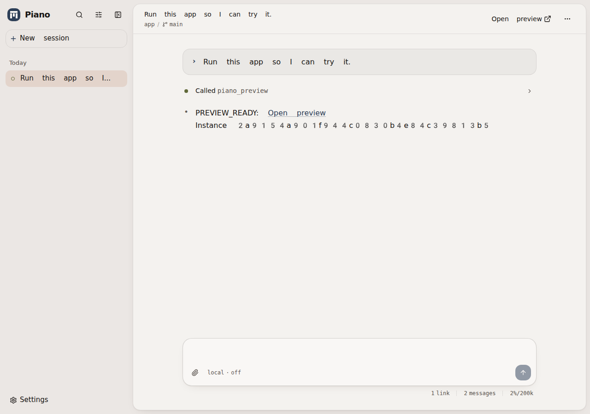
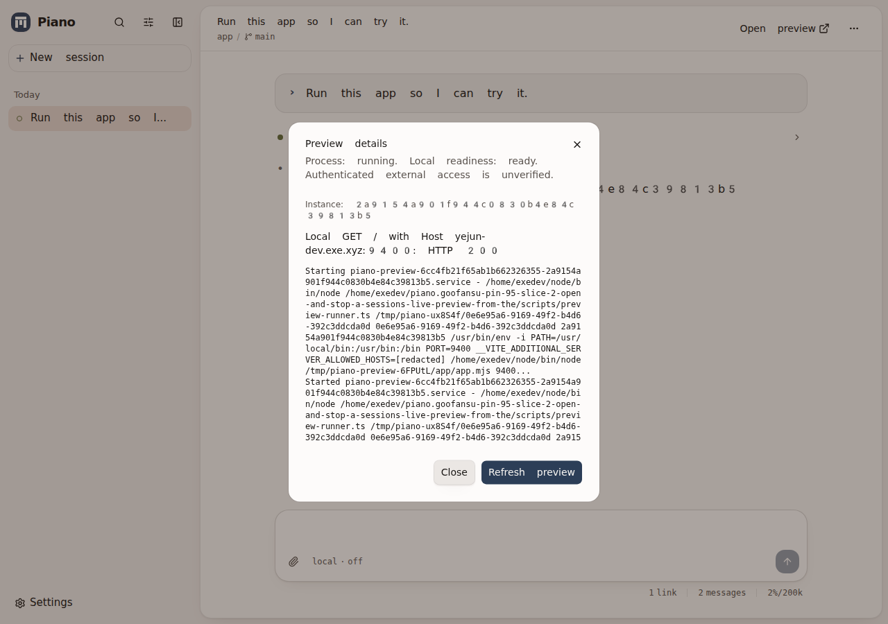

# PIN-95: live preview session controls

[Linear PIN-95](https://linear.app/goofansu/issue/PIN-95/slice-2-open-and-stop-a-sessions-live-preview-from-the-session-ui)
— verified 2026-10-23 on exe.dev, Linux 6.12.113, Node 24.22.0, systemd 255,
installed Pi 1.4.0, agent-browser 0.39.2.

## Tested inputs

- Application and browser journeys: clean `d28088d3e40f474e1dd823e8feaf82236d5ec2db`.
- Final typecheck, lint and module suite: clean `ffa39520ec728fd7a6f00842f016cb67a3ac5107`.
  Its only difference is making the new test use the native supervisor fixture and a Node command.
- This follow-up adds only this report and screenshots; no application changes.
- Scratch backend/Vite, isolated database, HOME and Pi directories, throwaway Git repositories,
  loopback control ports. The preview journey uses real Pi, a scripted loopback model (no provider
  credentials/credits), real systemd units and a Vite app. Module tests use `test/fake-pi.mjs`.
  Harnesses clean their own processes/services/repositories. No deployment or live checkout changes;
  the user's Pi session files were not edited or deleted.

## Results

| Command | Result |
| --- | --- |
| `npm run typecheck` | Pass |
| `npm run lint` | Pass (Biome and Tailwind ESLint) |
| `npm test` | 1,021 pass, 0 fail, 15 native launchd cases skipped on Linux (1,036 total) |
| `npm run test:browser` | Pass: start-session, open-session, transcript-rows |
| `node test/browser/preview.mjs /tmp/pin95-evidence/final/preview` | Pass, 168.6 seconds |
| `node test/browser/style-shots.mjs <before/after-directory>` | Both pass; 22 pairs compared |

Style baseline was captured before UI edits at `3ed090b` plus the server/wire work. Eighteen pairs
are byte-identical. The other four were visually reviewed: three differ only in scratch path text,
one in the blinking composer caret. No existing-layout regression observed. These captures are in
`/tmp/pin95-evidence/style-before` and `style-after`; final command output and preview observations
are in `/tmp/pin95-evidence/final` (temporary local artifacts).

### Meaningful regression checks

`PiSessionsPreview.test.ts` exercises real owner admission and adapter logic through `PiSessions`,
with the supervisor boundary faked: automatic tool-completion projection; same-instance reconnect;
no observation for dormant/unattempted owners; independent workspaces and no competing-session
adoption; bounded on-demand logs; running-but-unready; supervisor failure becomes unknown; failed
stop retains uncertainty; stale exact-ID stop returns `not-current`; repeated stop is harmless;
Pi remains usable; confirmed stop permits idle retirement; exit clears the projection; reopen does
not relaunch. Audited fake-Pi input proves refresh and stop send no Pi requests.

Mutation check: temporarily clearing the projection for an adapter `not-current` result made the
new test fail at **“stale reply never clears the replacement”**. Restoring the fence passed. The
first full run exposed a test synchronization error: a prompt's deferred statistics readback could
arrive after the audit baseline. The test now waits for public `isQuiescent`, not a timer. Three
concurrent focused runs passed, followed by the full suite.

ClientSessions coverage now refuses preview actions on dormant sessions even with `start` options.
Command coverage checks exact IDs, hidden controls, unknown-state access to details, and retention
warnings for selected/background sessions. Existing ordered-store tests protect cross-session,
duplicate, stale-generation and gapped delivery. Existing SessionHosts cleanup-failure tests still
prove archive/delete retain the reference and report failure, not success.

### Observed browser journey

- Agent launch exposes the header control without reload. Header Open and keyboard-palette Open
  create a real tab at the preview hostname; local app load and HMR are observed separately.
- Header menu exposes process/readiness/access details and explicit refresh; logs stay on demand.
- Composer Stop, disconnect, session switching and reconnect preserve the original instance.
- Header Stop and keyboard-palette Stop remove the control, stop the exact app and allow idle
  retirement, without a model/tool invocation. Subsequent prompts still start new work normally.
- Pi SIGKILL and scratch Piano SIGTERM/SIGKILL clean up before reopening/restarting. Reopen has no
  control and does not relaunch. Measured SIGKILL cleanup was 5.33s (Pi) and 5.13s (Piano), under
  the journey's 15s bound, including a child that ignores TERM.
- Archive/Delete confirmations warn that the app will stop; actual app cleanup is observed.
  Archive still cleans up after removal of its scratch checkout.

## Boundaries and remaining gaps

Preserves INV-01/02/05/07/11/12/13: only ephemeral live-owner projections; ordered session delivery;
exact-instance stop through the existing owner gate; no stored preview associations, sidebar polling,
new model calls, proxy/auth changes or skill dependencies. Existing PIN-99 lifecycle remains in place.

Native macOS/launchd owner-death cleanup and authenticated external exe.dev access remain unverified,
as in PIN-99. Opening an external tab and loading the app over loopback do **not** prove authenticated
external access. Two-workspace isolation and late/stale replies are module/store evidence, not a
new two-worktree browser race simulation. Natural process changes become visible on explicit refresh,
not background polling. No physical mobile-device verification was performed.
